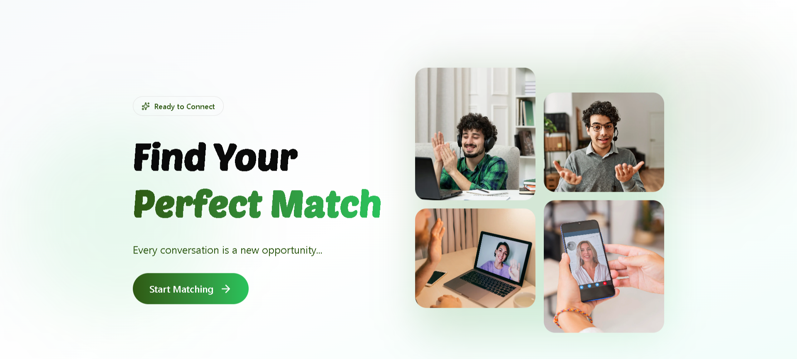
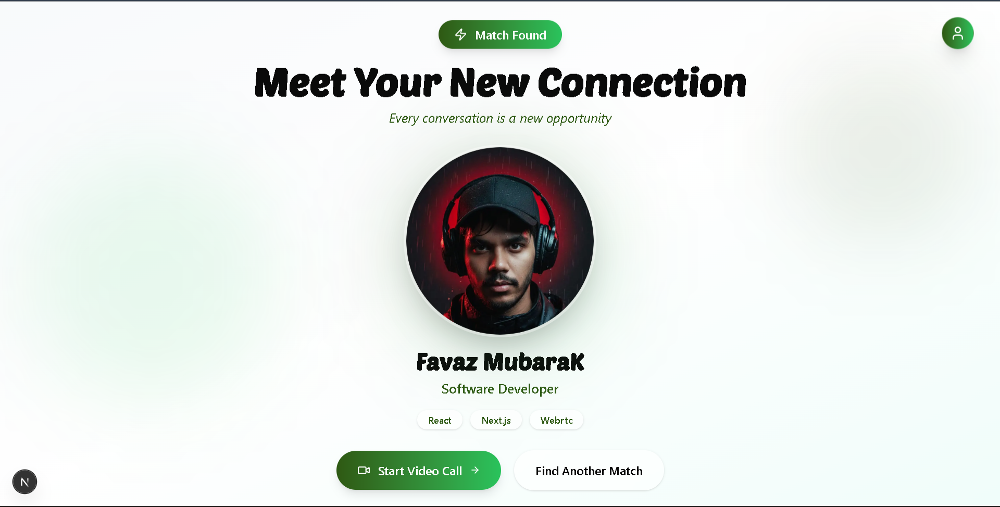
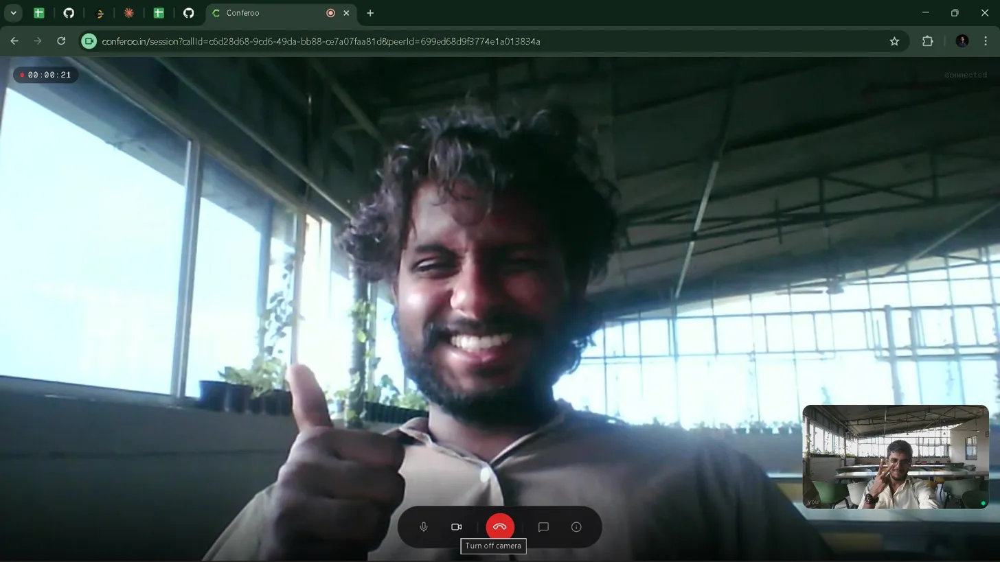
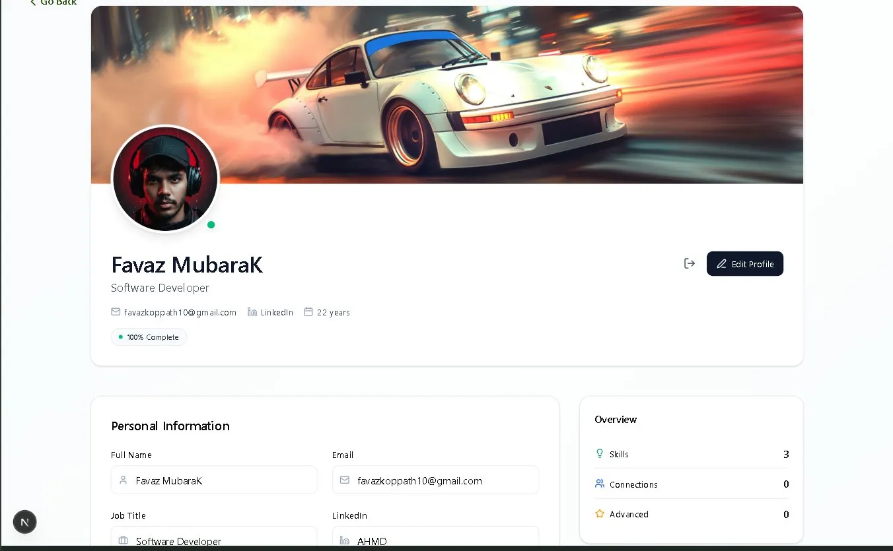
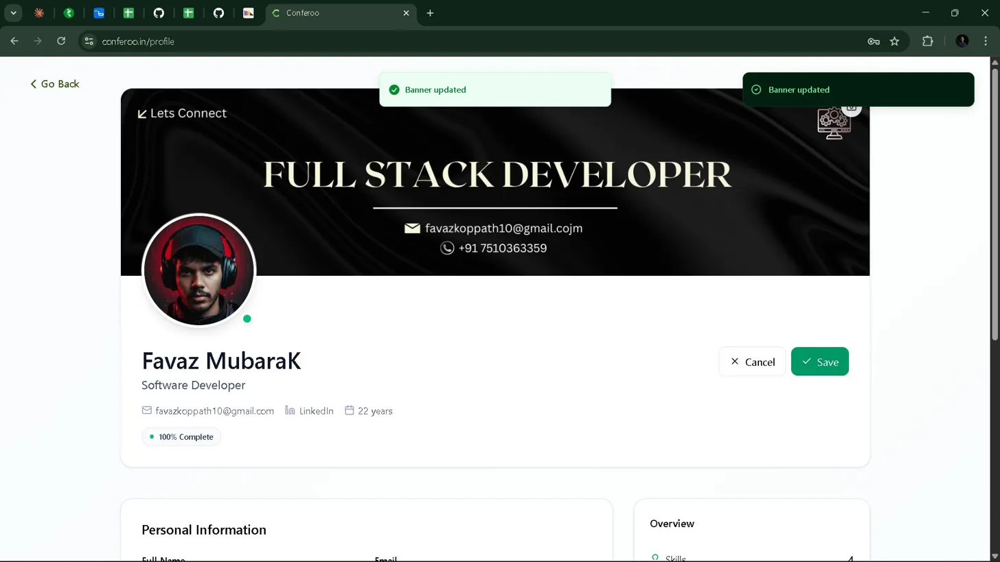
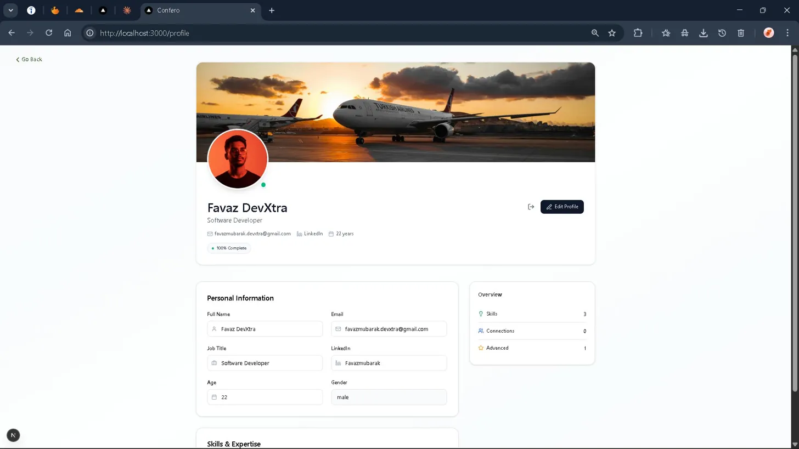
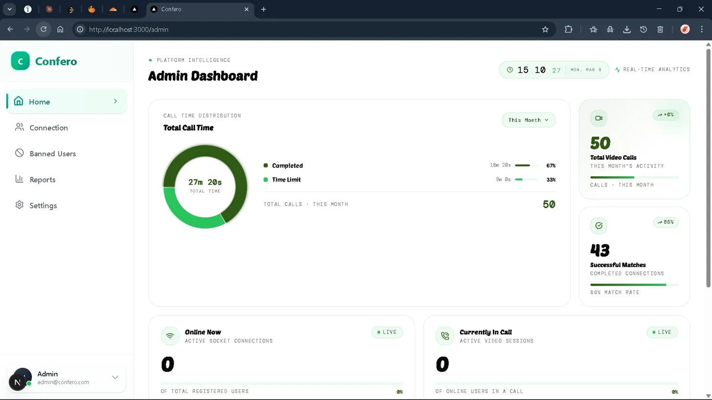
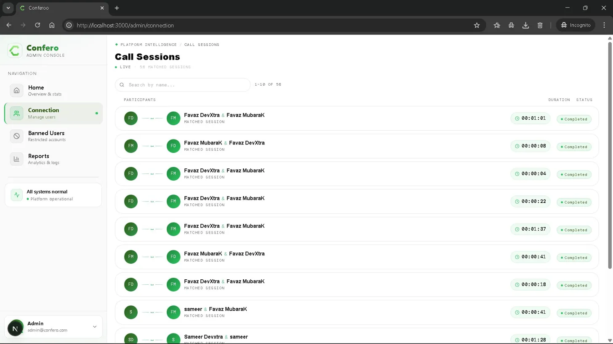
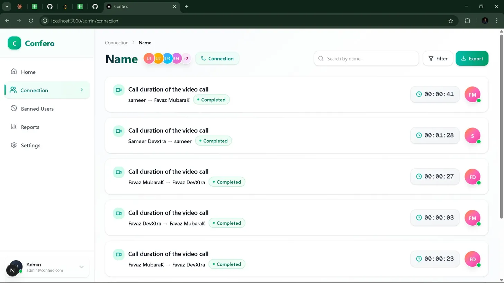

# Confero

Confero is a real-time skill-based video networking platform designed for low-latency video and voice interactions.

The project focuses on clean architecture, scalability, and practical real-world implementation of real-time systems using modern web technologies. Users create profiles with skill tags, enter a matchmaking queue, and are paired with someone who shares at least one skill — a live WebRTC video call begins automatically.

---

## Overview

Confero enables browser-based real-time audio and video communication with a clear separation of responsibilities across signaling, media transport, and background processing.

The codebase follows a **monorepo architecture**, keeping frontend and backend development unified while maintaining clear boundaries between concerns.

The goal is to build a system that is predictable under load, easy to reason about, and extensible for future features.

<br/>



---

## Key Features

- Real-time video and audio communication via WebRTC P2P
- WebSocket-based signaling layer with Socket.IO
- Skill-intersection matchmaking backed by Redis queues
- Two-sided readiness gate — call only starts when both users accept
- Duplicate tab guard using Redis `SCARD` checks
- OTP + Google OAuth 2.0 authentication
- JWT HTTP-only cookies with refresh token rotation
- Asynchronous session recording via RabbitMQ
- Fast in-memory presence management
- Full admin dashboard with real-time analytics
- Monorepo setup using pnpm workspaces

<br/>

<table>
<tr>
<td width="50%">



</td>
<td width="50%">



</td>
</tr>
<tr>
<td align="center"><sub>Skill-based match flow</sub></td>
<td align="center"><sub>Live P2P video session</sub></td>
</tr>
</table>

---

## User Profiles

Every user has a full profile — custom banner, avatar, job title, LinkedIn, and a skill list that drives the entire matching system.

<table>
<tr>
<td width="33%">



</td>
<td width="33%">



</td>
<td width="33%">



</td>
</tr>
<tr>
<td align="center"><sub>Profile with skill overview</sub></td>
<td align="center"><sub>Live banner update with toast confirmation</sub></td>
<td align="center"><sub>Full profile — personal info & expertise</sub></td>
</tr>
</table>

---

## Admin Panel

A full admin console gives platform operators real-time visibility — active socket connections, live call sessions, total video calls, match rate, call time distribution, and a searchable connection log.

<table>
<tr>
<td width="50%">



</td>
<td width="50%">



</td>
</tr>
<tr>
<td align="center"><sub>Platform intelligence dashboard</sub></td>
<td align="center"><sub>Live call session tracking</sub></td>
</tr>
</table>

<br/>



<p align="center"><sub>Connection log — full history with participants, duration & status</sub></p>

---

## Tech Stack

### Frontend


### Backend


### Infrastructure & Tools


---

## Architecture Overview

```
Client (Browser)
│
├── WebRTC (Media Streams — direct P2P, no server touch)
│
├── WebSocket Signaling ──► Live Service ──► Redis (presence, queues, locks)
│                                │
│                                └── RabbitMQ ──► Auth Service (session recording)
│
└── REST APIs ──► API Gateway ──► Auth Service (users, auth, admin)
                  (rate limiting,
                   reverse proxy)
```

This separation allows real-time media traffic to remain fully isolated from control logic and background processing. A database write failure never interrupts a live call.

---

## Monorepo Structure

- `frontend` — Next.js 15 App Router, UI, socket client
- `live-service` — WebSocket server, matchmaking engine, WebRTC signaling
- `services/auth-service` — Users, auth, sessions, bans, admin APIs
- `gateway` — Reverse proxy, rate limiting per IP
- `packages/shared` — Shared types and utilities

Managed using **pnpm workspaces** for consistent dependency control.

---

## Design Principles

- Explicit over implicit behavior
- Clear separation of concerns — controllers thin, logic in services, data access in repositories
- Real-time paths kept minimal and fast
- Event-driven workflows for non-blocking operations
- Maintainability prioritized over shortcuts

---

## Status

**Active development.**

Core real-time communication and signaling infrastructure is fully operational and deployed on Azure. Additional scalability, observability, and reliability improvements are ongoing — including moving call state to Redis for horizontal scaling and establishing test coverage starting with the matching engine.
